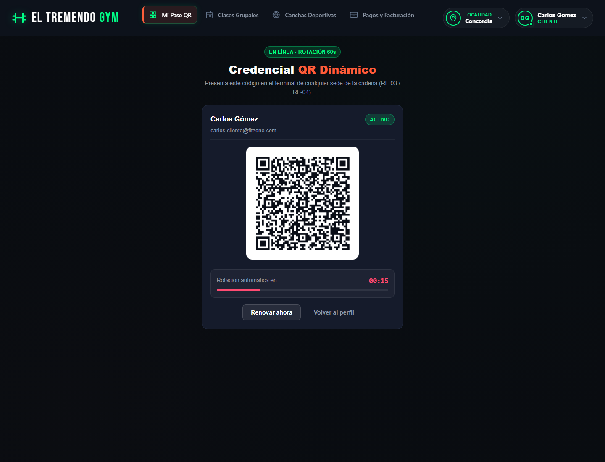
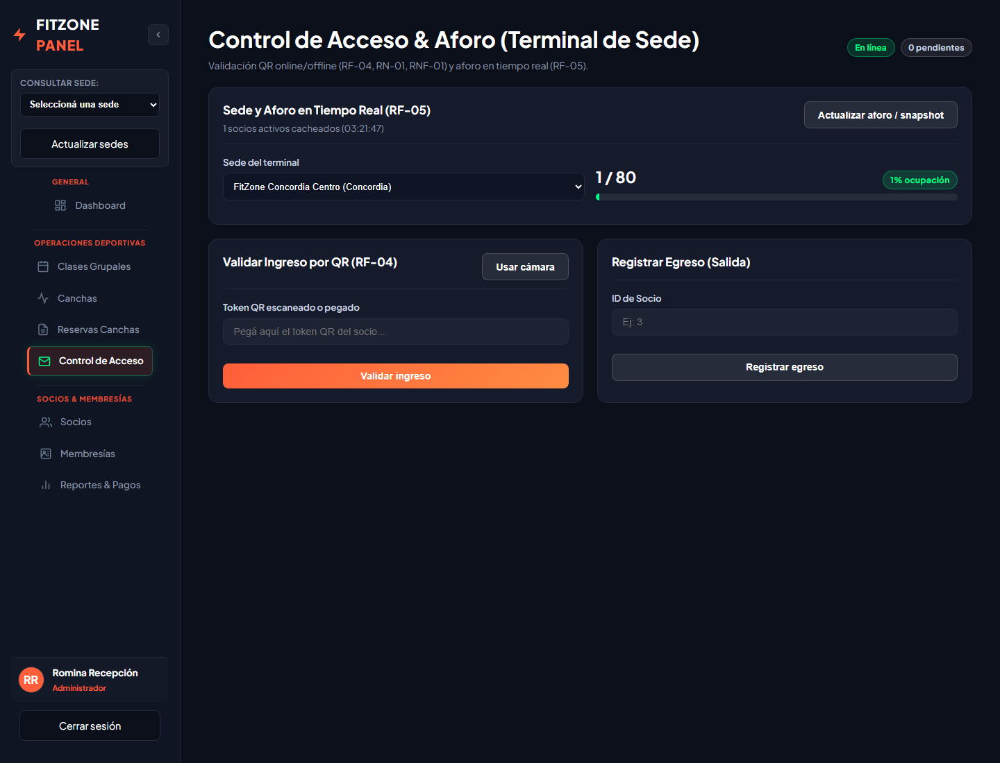
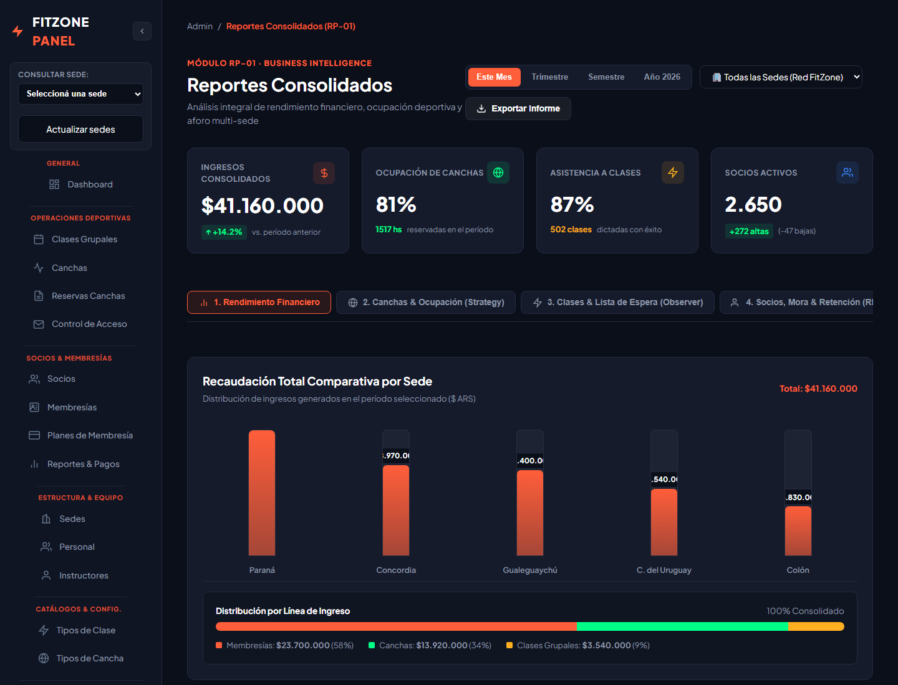

# Manual de usuario — FitZone Sports

**Versión:** 1.0 · **Sistema:** FitZone Sports · **Entorno ilustrado:** datos de demostración

## Índice

1. [Qué es FitZone Sports y para qué sirve](#1-qué-es-fitzone-sports-y-para-qué-sirve)
2. [Cómo leer este manual · Glosario de términos](#2-cómo-leer-este-manual--glosario-de-términos)
3. [Manual del Socio](#3-manual-del-socio)
   - [3.1 Registro y carga del perfil](#31-registro-y-carga-del-perfil)
   - [3.2 Contratación y renovación de la membresía](#32-contratación-y-renovación-de-la-membresía)
   - [3.3 Obtención del código QR desde el portal e ingreso al gimnasio](#33-obtención-del-código-qr-desde-el-portal-e-ingreso-al-gimnasio)
   - [3.4 Qué hacer si el QR no es aceptado o la sede está sin conexión](#34-qué-hacer-si-el-qr-no-es-aceptado-o-la-sede-está-sin-conexión)
   - [3.5 Reserva de clases grupales y lista de espera](#35-reserva-de-clases-grupales-y-lista-de-espera)
   - [3.6 Reserva de canchas y cómo se calcula el precio](#36-reserva-de-canchas-y-cómo-se-calcula-el-precio)
   - [3.7 Cancelaciones, plazos y penalidades](#37-cancelaciones-plazos-y-penalidades)
   - [3.8 Comprobantes de pago](#38-comprobantes-de-pago)
4. [Manual del Recepcionista / Administrador de sede](#4-manual-del-recepcionista--administrador-de-sede)
   - [4.1 Validación de ingreso y lectura del aforo](#41-validación-de-ingreso-y-lectura-del-aforo)
   - [4.2 Gestión de la agenda de clases](#42-gestión-de-la-agenda-de-clases)
   - [4.3 Inhabilitación de una cancha por mantenimiento](#43-inhabilitación-de-una-cancha-por-mantenimiento)
   - [4.4 Problemas frecuentes del mostrador y cómo resolverlos](#44-problemas-frecuentes-del-mostrador-y-cómo-resolverlos)
5. [Manual del Gerente central](#5-manual-del-gerente-central)
   - [5.1 Alta y configuración de una sede](#51-alta-y-configuración-de-una-sede)
   - [5.2 Definición de precios, descuentos y horario pico](#52-definición-de-precios-descuentos-y-horario-pico)
   - [5.3 Lectura de los reportes consolidados](#53-lectura-de-los-reportes-consolidados)
6. [Preguntas frecuentes](#6-preguntas-frecuentes)

## 1. Qué es FitZone Sports y para qué sirve

FitZone Sports administra sedes de gimnasios y complejos deportivos. Desde el portal, las personas pueden consultar su cuenta, gestionar la membresía, obtener un pase QR, reservar clases grupales y canchas, y consultar pagos. El panel administrativo permite operar accesos y aforo, agenda, sedes, canchas, socios, membresías y planes.

El sistema distingue el rol **Cliente** de la condición de **socio**: una persona es socio si tiene una membresía; un cliente sin membresía conserva una cuenta, pero no los beneficios asociados a una membresía activa.

> Las cuentas y operaciones que aparecen en las capturas son datos de demostración. La pasarela de pago del proyecto es simulada; no ingreses datos de tarjetas reales.

## 2. Cómo leer este manual · Glosario de términos

Los pasos describen las pantallas de la aplicación. Los nombres entre comillas identifican botones, campos o estados visibles. Una cuenta de demostración sirve para practicar; en una instalación propia, usá las credenciales que haya configurado el administrador.

- **Socio:** cliente con una membresía registrada.
- **Membresía activa:** habilita beneficios de socio, como el descuento configurado para canchas.
- **Cliente externo:** cuenta sin membresía.
- **Pase QR dinámico:** código de acceso que se renueva cada 60 segundos.
- **Aforo:** ocupación registrada de una sede respecto del máximo configurado.
- **Lista de espera:** fila de inscripción a una clase sin lugares disponibles; al liberarse una plaza, el sistema puede promover a la siguiente persona.
- **Modo offline:** validación local cuando el terminal pierde conexión; los ingresos aceptados quedan pendientes de sincronización.
- **Horario pico:** franja horaria a la que se aplica el recargo definido por el motor de precios.

## 3. Manual del Socio

Ingresá al portal en `http://localhost:5173` en la instalación de desarrollo. Seleccioná **Iniciar sesión** e ingresá el correo y la contraseña de la cuenta.

### 3.1 Registro y carga del perfil

La versión actual no ofrece un formulario público para crear una cuenta. El alta la realiza personal autorizado desde el panel, en **Personal** o **Socios**; solicitá al administrador de tu sede el correo de acceso.

Una vez dentro del portal:

1. Abrí el menú de tu cuenta y elegí **Mi perfil**.
2. Entrá en **Editar perfil** para actualizar los datos personales y de contacto disponibles.
3. Guardá los cambios y revisá el perfil para confirmar que se reflejaron.

No compartas la contraseña. Si no podés iniciar sesión o el correo no está registrado, pedí al administrador de tu sede que revise la cuenta.

### 3.2 Contratación y renovación de la membresía

1. En **Mi perfil**, revisá el estado y vigencia de tu membresía.
2. Seleccioná un plan (Mensual, Trimestral o Anual) y definí si querés renovación automática simulada.
3. Elegí **Contratar Plan** si todavía no tenés una membresía, o **Renovar / Reactivar Membresía** si ya existe.
4. Una contratación nueva queda en estado **PENDIENTE_PAGO**. Usá **Pagar para activar membresía** y completá el flujo de pago de demostración en **Pagos / Facturación**.
5. Volvé al perfil y comprobá que el estado figure como **ACTIVO**.

La renovación automática es una preferencia simulada; no implica un débito real. Una membresía vencida o suspendida aparece con un aviso y no conserva el descuento de socio para canchas.

### 3.3 Obtención del código QR desde el portal e ingreso al gimnasio

1. Iniciá sesión con la cuenta del socio.
2. Desde el menú o los accesos del perfil, abrí **Mi Pase QR**.
3. Presentá el código vigente en el lector de recepción. El contador informa cuándo rota; cada código tiene una ventana de validez de 60 segundos.
4. Esperá la confirmación del personal antes de ingresar.

La captura siguiente muestra el pase del socio Carlos Gómez en la aplicación real de demostración. El QR de la imagen ya venció y no debe utilizarse como credencial.

*Figura 1. Pase QR del socio, capturado desde el portal en ejecución.*

### 3.4 Qué hacer si el QR no es aceptado o la sede está sin conexión

- **Código vencido:** esperá la renovación automática o pulsá **Renovar ahora** y volvé a mostrarlo.
- **Rechazo por membresía vencida o suspendida:** revisá el estado en **Mi perfil** y consultá al personal para renovar/reactivar la membresía.
- **Rechazo por uso duplicado o sede distinta:** informá al recepcionista. El sistema evita ingresos incompatibles entre sedes y el personal puede explicar el motivo devuelto.
- **Sede sin conexión:** el terminal puede validar contra el snapshot local de socios activos y encolar el ingreso. Si el personal confirma que fue autorizado, no repitas el intento varias veces; la operación se sincroniza cuando vuelve la red.
- **Sin QR en pantalla:** verificá tu sesión y conexión. El QR en caché puede ser el último emitido y no necesariamente seguirá siendo válido; seguí la indicación del recepcionista.

El modo offline depende de que el terminal haya descargado previamente el snapshot. No garantiza el acceso si el socio no está en esa copia local.

### 3.5 Reserva de clases grupales y lista de espera

1. Abrí **Clases Grupales** e iniciá sesión.
2. Filtrá por sede y revisá horario, instructor y cupos libres.
3. En una clase con lugares, pulsá **Reservar Cupo**. La reserva se confirma si la operación fue aceptada.
4. Si aparece **Cupo completo**, pulsá **Anotarme en Lista de Espera**. Podés ver tu posición en **Mi Lista de Espera**.

La aplicación permite reservar hasta 48 horas antes del inicio. Al cancelarse una plaza, el sistema puede promover automáticamente a la siguiente persona de la lista. La promoción depende de que la vacante y la lista sigan vigentes.

### 3.6 Reserva de canchas y cómo se calcula el precio

1. Abrí **Canchas Deportivas** y seleccioná sede, cancha, fecha y turno disponible.
2. Revisá el detalle del precio antes de confirmar. El turno queda pendiente de pago o confirmado según el flujo que muestre la pantalla.
3. Completá el pago de demostración desde **Pagos / Facturación**, si corresponde.

El cálculo del backend usa el precio base por hora y suma los ajustes aplicables:

| Condición | Ajuste implementado |
|---|---:|
| Membresía en estado `ACTIVO` | 15 % de descuento sobre el precio base |
| Inicio del turno a las 19:00 o 20:00 | 20 % de recargo sobre el precio base |
| Cliente externo o membresía vencida/suspendida | Sin descuento de socio |

Si se cumplen ambas condiciones, descuento y recargo se calculan por separado sobre el precio base: `base − descuento + recargo`. Los beneficios descriptivos de un plan no cambian el precio final que calcula el backend.

### 3.7 Cancelaciones, plazos y penalidades

- **Clases:** se pueden reservar con hasta 48 horas de anticipación. La cancelación queda sin penalidad con 2 horas o más antes del inicio. Con menos de 2 horas se registra con penalidad; la pantalla solicita confirmar.
- **Canchas:** una reserva pagada cancelada con 24 horas o más de anticipación no tiene penalidad. Con menos de 24 horas se retiene el 50 % del importe pagado y se informa el monto reembolsable. Una reserva aún no pagada no genera esa retención.
- Una actividad ya comenzada no puede cancelarse desde estos flujos.

Antes de confirmar, leé el aviso de la aplicación y conservá el identificador de la reserva para consultas.

### 3.8 Comprobantes de pago

Abrí **Pagos / Facturación**, ubicá el pago y usá la acción para ver o descargar el comprobante PDF. El comprobante corresponde a pagos registrados. Si un pago aparece pendiente o rechazado, revisá el estado y consultá al personal autorizado.

Los comprobantes de esta instalación son de demostración y no representan transacciones bancarias reales.

## 4. Manual del Recepcionista / Administrador de sede

Abrí `http://localhost:5173/admin/login` e iniciá sesión con una cuenta de rol **Administrador** asignada a tu sede. No compartas esa sesión con los socios.

### 4.1 Validación de ingreso y lectura del aforo

1. En el menú lateral, abrí **Control de Acceso**.
2. Confirmá la sede del terminal en el selector y revisá el indicador **En línea / Modo offline**, los pendientes y el aforo `actual / máximo`.
3. Pulsá **Usar cámara** para leer el QR, o pegá el token en **Token QR escaneado o pegado** y elegí **Validar ingreso**.
4. Permití el acceso solo si el resultado indica autorización. Consultá el aviso si se deniega.
5. Para registrar una salida, ingresá el ID de socio en **Registrar Egreso** y confirmá.
6. Cuando vuelva la conexión, revisá la cola y elegí **Sincronizar ahora** si hay registros pendientes. Atendé los conflictos mostrados.

El aforo se actualiza con los registros de acceso y egreso. En modo offline, el conteo local puede ser provisional hasta sincronizar. Para usar la cámara desde otro dispositivo, el navegador requiere HTTPS; el proyecto expone un certificado autofirmado para pruebas.

*Figura 2. Panel de control de acceso del recepcionista de demostración.*

### 4.2 Gestión de la agenda de clases

1. Abrí **Clases Grupales** en el panel.
2. Revisá las clases programadas y filtrá según las opciones disponibles.
3. Para agregar una clase, elegí **Nueva clase**, completá tipo, sede, instructor, horario y capacidad, y confirmá.
4. Para revisar las inscripciones pendientes, abrí **Lista de Espera**.

Antes de crear una clase, verificá con el instructor y la sede que el horario y la capacidad sean correctos. La disponibilidad del socio se actualiza desde las reservas.

### 4.3 Inhabilitación de una cancha por mantenimiento

1. Abrí **Canchas** o **Inventario de Canchas**.
2. Buscá la cancha por sede y nombre y abrí su ficha o acciones.
3. Elegí **Pasar a mantenimiento** y confirmá el cambio de estado.
4. Comprobá que figure **En mantenimiento** y que no admita nuevas reservas.

Al terminar, usá la acción para habilitar/disponibilizar, si aparece en la ficha. Si no está disponible, escalá el cambio al gerente. No crees una cancha nueva para reemplazar una existente sin autorización.

### 4.4 Problemas frecuentes del mostrador y cómo resolverlos

| Situación | Qué revisar / hacer |
|---|---|
| QR rechazado | Confirmá que se leyó el token completo, revisá el mensaje y pedí al socio renovar el QR. No fuerces el ingreso. |
| No hay conexión | Verificá el indicador de red y que exista snapshot local. Usá el flujo offline y revisá luego la cola y conflictos. |
| Aforo no se actualiza | Actualizá aforo/snapshot; comprobá que se registren ingresos y egresos. El valor offline puede ser provisional. |
| Cámara no abre | Verificá permiso de cámara y HTTPS. Usá la entrada manual del token como alternativa. |
| Clase llena | Informá que puede anotarse en la lista de espera; no confirmes un cupo fuera del sistema. |
| Cancha indisponible | Revisá sede, fecha, turno y mantenimiento. Derivá cambios que no estén habilitados a gerencia. |
| Sesión vencida / sin permisos | Iniciá sesión con la cuenta correcta. No uses credenciales de gerente para el trabajo diario. |

## 5. Manual del Gerente central

Iniciá sesión con la cuenta de rol **Gerente** desde el panel. Revisá los cambios administrativos antes de confirmarlos, porque pueden afectar la operación de las sedes.

### 5.1 Alta y configuración de una sede

1. Abrí **Sedes** en el menú lateral.
2. Elegí **Nueva sede**.
3. Completá nombre, dirección, localidad y aforo máximo (entero positivo).
4. Guardá y verificá la ficha creada.

La versión actual permite dar de alta sedes, pero la edición de una sede existente todavía no está disponible en la API. Cargá cuidadosamente los datos antes de confirmar y contactá al equipo técnico si necesitás corregirlos.

### 5.2 Definición de precios, descuentos y horario pico

Abrí **Catálogos & Configuración → Configuración** para consultar las reglas vigentes. La pantalla es de solo lectura para estrategias y parámetros operativos. El motor implementa precio base por hora, descuento del 15 % para membresía activa y recargo del 20 % para turnos que comienzan a las 19:00 o 20:00. Externos y membresías vencidas/suspendidas no reciben el descuento.

Los **planes de membresía** sí se administran desde **Planes de Membresía**. Los precios por hora de canchas se consultan en su ficha/inventario. Descuentos y horario pico no se editan desde esta consola; requieren un cambio del motor de precios y un despliegue técnico.

### 5.3 Lectura de los reportes consolidados

1. Abrí **Reportes & Pagos**.
2. Seleccioná el período y, cuando corresponda, la sede.
3. Recorre las pestañas de ingresos, canchas, clases y socios.
4. La interfaz ofrece una acción de exportación de demostración.

**Importante:** los reportes actuales se alimentan de datos de ejemplo definidos en el frontend (`reportesConfigData`); no son una consulta consolidada de las operaciones reales de PostgreSQL. No los uses para liquidaciones, decisiones contables ni seguimiento real hasta que esa fuente se conecte a datos productivos y se validen los resultados.

*Figura 3. Panel de reportes de la cuenta gerente. Los indicadores visibles son datos ilustrativos.*

## 6. Preguntas frecuentes

**¿Puedo crear mi propia cuenta?** No desde el portal actual. Pedí el alta al personal autorizado.

**¿El QR sirve para siempre?** No. Rota cada 60 segundos; usá el código vigente del portal.

**¿La renovación automática cobra mi tarjeta?** No en esta versión. Es una preferencia simulada y el pago también es de demostración.

**¿Por qué no recibo el descuento de canchas?** El backend aplica el descuento cuando la membresía está `ACTIVO`. Clientes externos y membresías vencidas o suspendidas usan tarifa sin descuento.

**¿Qué pasa si se libera una plaza de una clase?** El sistema puede promover automáticamente a la siguiente persona elegible; revisá el estado en el portal.

**¿Puedo cancelar una cancha pagada el mismo día?** El sistema aplica una retención del 50 % si faltan menos de 24 horas; revisá el importe antes de confirmar.

**¿Dónde informo un error?** Compartí con el administrador la pantalla, hora aproximada e identificador de reserva o pago. Nunca envíes tu contraseña.
